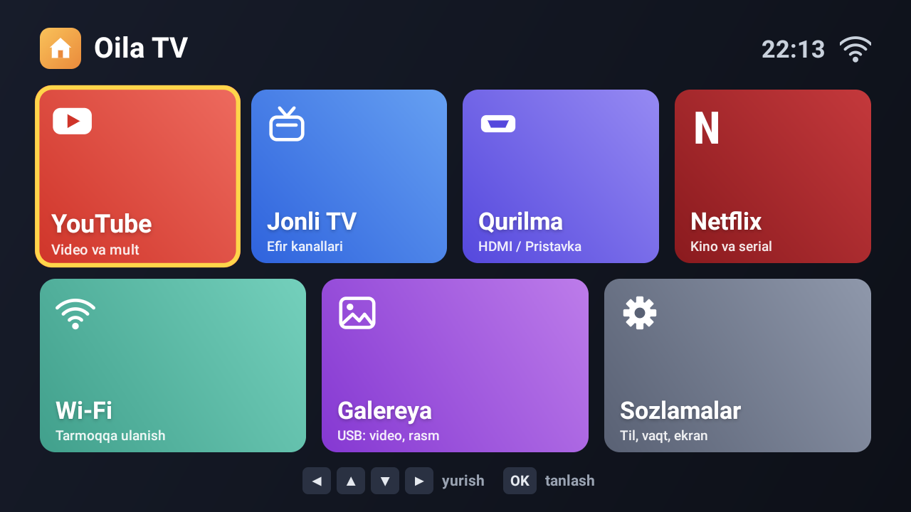

# Oila TV

A tiny, fast, ad-free home screen for low-end Android smart TVs — big tiles, big text,
built for grandparents and kids. Interface language: Uzbek.



- **~20 KB APK**, no libraries, no image assets — every icon is drawn in code.
- **~9 MB RAM** at runtime, starts in about half a second on a 1 GB TV.
- Remote-first: D-pad focus with a clear yellow ring, no dead ends.
- No ads, no tracking, no network calls of its own.

## Tiles

| Tile | Opens |
|---|---|
| YouTube | YouTube for Android TV |
| Jonli TV | The TV's own tuner (antenna/cable channels) |
| Qurilma | Input source picker (HDMI, AV) |
| Netflix | Netflix |
| Wi-Fi | Network settings |
| Galereya | Media player for USB video/photos |
| Sozlamalar | System settings |

## Tested on

Premier TV6681 (MediaTek MT5621 board, Android 9, 1280×720, 1 GB RAM). The tuner, source
picker and settings tiles use the KTC-platform apps present on that family of TVs
(`com.ktc.tvplayer`, `com.ktc.setting`, `com.ktc.media`); on other TVs those tiles fall back to
standard Android intents where one exists.

## Build

Needs a JDK and the Android SDK (build-tools 35, platform android-35). No Gradle.

```sh
./build.sh            # -> build/oila-tv.apk, signed with ~/.android/debug.keystore
```

## Install

Enable ADB on the TV, then from a computer on the same network:

```sh
adb connect <tv-ip>:5555
adb install -r build/oila-tv.apk
./tv-tune.sh <tv-ip>:5555 apply      # make it the home screen + trim background apps
./tv-tune.sh <tv-ip>:5555 rollback   # restore the stock launcher and settings
```

`apply` sets Oila TV as the default home, disables the stock launcher and the vendor ad
services that run in the background, and shortens system animations. Every step is
reversible with `rollback`.

## License

MIT
